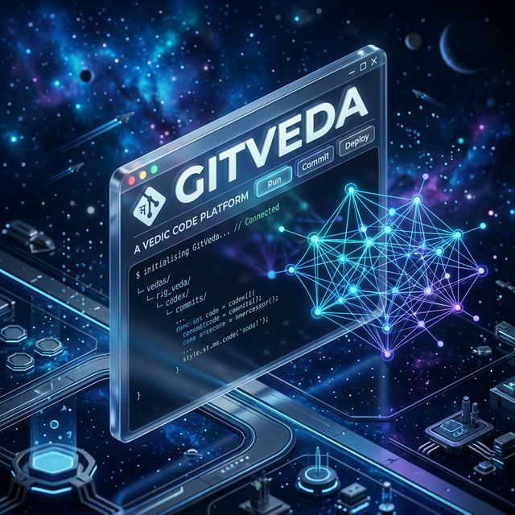
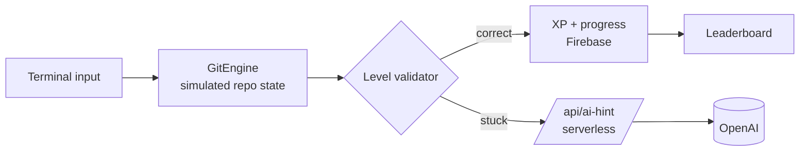

<div align="center">



# GitVeda

**Learn Git by playing it: 30 levels, a terminal in your browser, and an AI tutor when you get stuck.**

[](https://git-veda-phi.vercel.app)
[](https://vitejs.dev/)
[](https://firebase.google.com/)
[](https://platform.openai.com/)
[](https://vitest.dev/)
[](CONTRIBUTING.md)

**[▶ Play GitVeda](https://git-veda-phi.vercel.app)** · [Curriculum](#the-curriculum) · [How it works](#how-it-works) · [Run locally](#run-locally)

</div>

---

## Why

Most people learn Git by memorising commands they are afraid to run. The first time they need `rebase`, `reflog` or `bisect` is usually during a real emergency, on a real repository.

GitVeda gives you a **safe sandbox repository** inside the browser. You type real commands, see what they do to the repository, earn XP, and only move on once you can do it yourself.

## Features

| | |
|---|---|
| 🖥️ **In-browser Git terminal** | A simulated Git engine tracks the working tree, staging area, commits and branches as you type. Nothing to install, and nothing you can break. |
| 🗺️ **30-level campaign** | Each level is a real scenario ("inspect unstaged changes before you commit") with a command to run and a concept check. |
| 🎯 **Three tiers** | Easy, Medium and Hard levels award 80, 120 and 170 XP. |
| 🤖 **AI hints** | Stuck? A serverless function asks OpenAI for a hint that nudges you toward the answer without giving it away. |
| 🏆 **Leaderboard and profile** | XP, streaks and progress saved to Firebase, ranked against other learners. |
| 📒 **Cheat notes** | A one-page reference of every command you have unlocked. |
| 🔁 **Endgame** | *Final Revision*, a rapid-fire recap of all 30 commands for +500 XP, and *Practice Arena* for unlimited drills. |

## The curriculum

| Tier | Levels | Commands you master |
|---|---|---|
| **Easy** · foundations | 1–10 | `init` · `status` · `add` · `commit` · `log --oneline` · `branch` · `checkout -b` · `switch` · `diff` · `restore` |
| **Medium** · collaboration | 11–20 | `remote add` · `push -u` · `pull --rebase` · `fetch --all` · `merge` · `rebase` · `stash push` · `stash pop` · `cherry-pick` · `reset --soft` |
| **Hard** · recovery and mastery | 21–30 | `reset --hard` · `reflog` · `bisect start / bad / good` · `rebase -i` · `commit --amend` · `clean -fd` · `tag -a` · `push --tags` |

## How it works



- **State, not string matching.** `GitEngine` keeps a model of the repository, and reducers (`gitEngineReducer`, `challengeReducer`, `userProgressReducer`) move the game forward.
- **The API key stays secret.** AI hints go through a Vercel serverless function in `api/ai-hint.js`, so the OpenAI key never reaches the browser.
- **Fast first load.** Pages are lazy-loaded and the expensive views are memoised.

## Tech stack

| Layer | Technology |
|---|---|
| UI | React 18, Vite, React Router, Framer Motion, Sass, Lucide icons, Recharts |
| State | React Context and reducers, custom hooks (`useGitEngine`, `useTerminal`, `useChallenge`, `useLeaderboard`) |
| Backend | Firebase Auth and Firestore, a Vercel serverless function for AI hints |
| Testing | Vitest |

## Run locally

```bash
git clone https://github.com/kartikeyajay2006/GitVeda.git
cd GitVeda
npm install
cp .env.example .env     # add your Firebase config; OPENAI_API_KEY is only needed for AI hints
npm run dev              # http://localhost:5173
```

| Script | |
|---|---|
| `npm run dev` | Start the dev server |
| `npm run build` | Production build |
| `npm run preview` | Preview the build |
| `npm test` | Run tests with Vitest |

## Project structure

```text
src/
  services/gitSimulator/GitEngine.js   the simulated Git repository
  data/levels.js                       30 levels + endgame tracks
  reducers/                            git engine, challenge and progress state
  hooks/                               useGitEngine, useTerminal, useChallenge, useLeaderboard, ...
  pages/                               Home, Learn, Challenge, Leaderboard, Profile, CheatNotes, Auth
api/ai-hint.js                         serverless AI hint endpoint
```

## Contributing

New levels are welcome. Add a blueprint to `src/data/levels.js` and see [CONTRIBUTING.md](CONTRIBUTING.md).

## Author

Built by **[Kartikeya Yadav](https://github.com/kartikeyajay2006)**.
[LinkedIn](https://www.linkedin.com/in/kartikeya2006/) · [Portfolio](https://kartikeya-portfolio-rx7w.vercel.app/)
